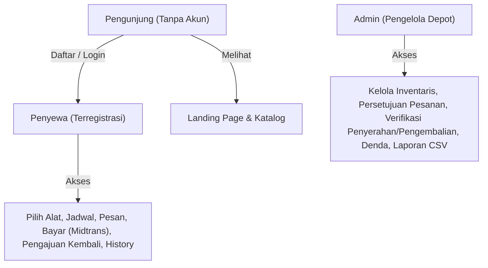
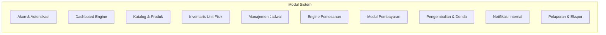
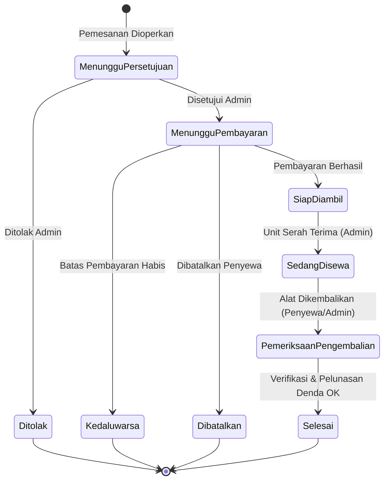
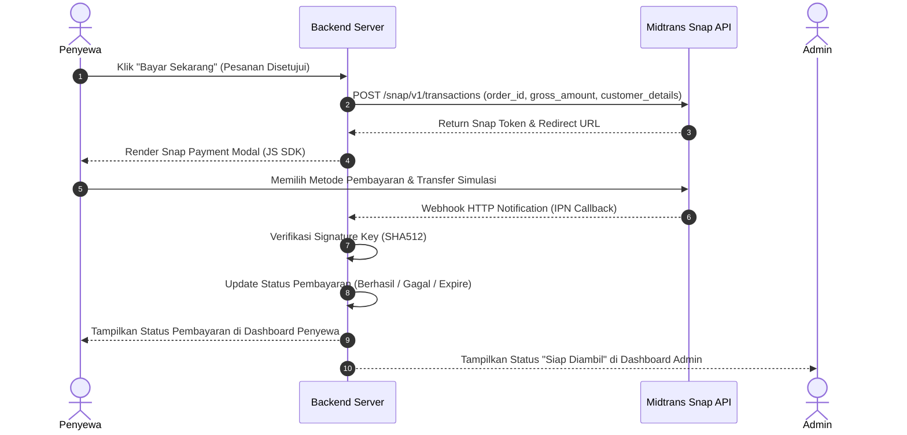
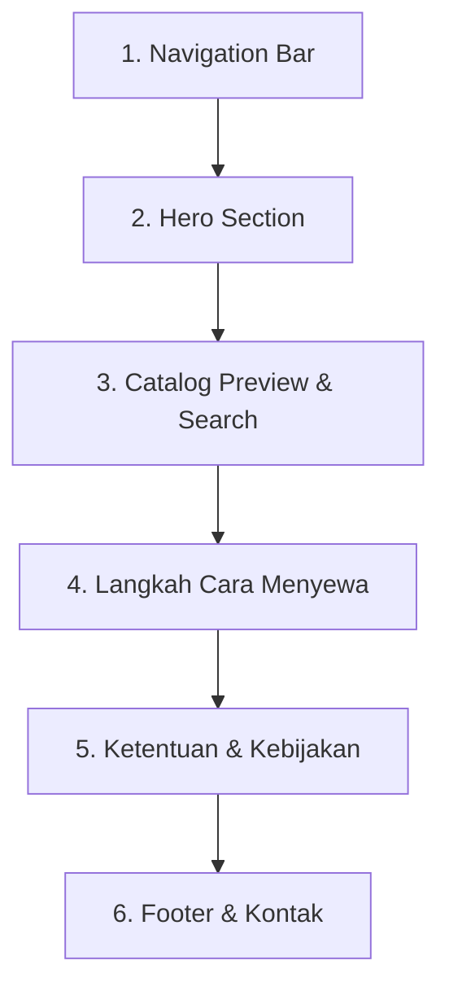
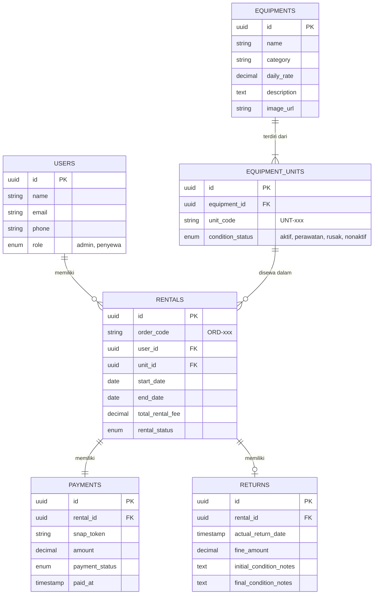

# Dokumen Perencanaan & Konsep Sistem Penyewaan Alat Tani

> **Versi Dokumen:** 1.0.0  
> **Status:** Draft Perencanaan Konsep & Spesifikasi Sistem  
> **Tema Desain:** Hijau Alami (`#195B3E`) & Cream Soft (`#FAF5E9`)

---

## 1. Ringkasan Eksekutif & Asumsi Dasar

Sistem Penyewaan Alat Tani adalah platform berbasis web yang menghubungkan pengelola penyewaan alat pertanian (Admin) dengan pengguna/petani (Penyewa). Platform ini memfasilitasi pencarian alat, pengecekan ketersediaan jadwal, pemesanan, pembayaran digital, hingga manajemen penyerahan dan pengembalian unit fisik.

### Asumsi Operasional Awal
1. **Perhitungan Durasi Sewa:** Dihitung secara **harian** (minimal 1 hari / 24 jam).
2. **Metode Penyerahan Unit:** Alat diambil dan dikembalikan secara langsung di **lokasi pengelola/depot** (*Self Pickup & Return*).
3. **Manajemen Unit Fisik:** Setiap item barang di katalog memiliki satu atau lebih **unit fisik unik** yang diidentifikasi menggunakan **Kode Inventaris Unik** (contoh: `UNT-TKT-001`, `UNT-TKT-002`).

---

## 2. Pengguna & Peran (Roles & Permissions)



* **Pengunjung (Guest):** Melihat landing page, menjelajahi katalog alat, filter kategori, dan melihat detail tarif tanpa login. Harus mendaftar sebelum melakukan pemesanan.
* **Penyewa (User):** Memiliki akun aktif, mengelola profil, memesan alat, melakukan pembayaran via Midtrans Snap, memantau status sewa, serta mengajukan pengembalian.
* **Admin (Manager/Staff):** Mengelola master data alat & unit fisik, menyetujui/menolak pesanan, mencatat verifikasi fisik awal & akhir, mengelola denda, serta mengunduh laporan keuangan/penyewaan.

---

## 3. Alur Proses Bisnis End-to-End (10 Tahapan)

| Tahap | Aktivitas Penyewa | Aktivitas Admin | Respons & Automasi Sistem |
| :--- | :--- | :--- | :--- |
| **1. Persiapan Alat** | — | Input data alat, jumlah unit fisik, kode inventaris, kondisi, tarif harian, dan foto | Menampilkan data alat pada katalog publik jika berstatus *Aktif*. |
| **2. Pendaftaran** | Mengisi form pendaftaran (Nama, Email, Telepon, Sandi) & melakukan login | Menggunakan kredensial admin yang diproteksi/ditentukan sistem | Memverifikasi kredensial, otomatis menetapkan role sebagai *Penyewa*. |
| **3. Pemilihan Alat** | Menelusuri katalog, membuka detail alat, serta memilih rentang tanggal sewa | Memastikan kondisi fisik unit riil sesuai dengan data di sistem | Memeriksa ketersediaan unit fisik bebas bentrok pada rentang tanggal yang dipilih. |
| **4. Pemesanan** | Mengisi formulir kebutuhan sewa dan mengajukan pemesanan | Menerima pemberitahuan pesanan masuk di dashboard admin | Menghitung estimasi total biaya sewa dan menahan jadwal unit sementara. |
| **5. Persetujuan** | Menunggu verifikasi pesanan oleh admin | Memeriksa ketersediaan fisik dan jadwal alat, lalu **Menyetujui** atau **Menolak** | Memperbarui status sewa menjadi *Menunggu Pembayaran* (jika disetujui) atau *Ditolak* (dengan alasan). |
| **6. Pembayaran** | Melakukan checkout simulasi melalui Midtrans Snap Sandbox | Memantau status pembayaran masuk via dashboard | Menangkap webhook/IPN Midtrans, memverifikasi signature, dan menentukan status *Berhasil*, *Tertunda*, *Gagal*, atau *Kedaluwarsa*. |
| **7. Pengambilan** | Datang ke lokasi pengelola sesuai jadwal awal sewa | Memeriksa ID penyewa, menjelaskan tata cara penggunaan, dan mencatat kondisi awal unit | Mengubah status transaksi menjadi **Sedang Disewa** dan mengunci status unit. |
| **8. Pengembalian** | Mengembalikan fisik alat ke lokasi dan mendampingi pemeriksaan | Memeriksa kelengkapan, waktu kembalian aktual, dan kondisi fisik alat | Menghitung keterlambatan (jika ada), menampilkan biaya tambahan/denda & catatan kondisi fisik. |
| **9. Penyelesaian** | Memeriksa rincian akhir transaksi dan melunasi denda (jika ada) | Menandai transaksi selesai setelah alat diterima dan seluruh kewajiban dilunasi | Memperbarui status transaksi menjadi **Selesai** & mengembalikan status unit ke **Aktif**. |
| **10. Pelaporan** | Melihat riwayat transaksi & mencetak/mengunduh bukti sewa mandiri | Memfilter data transaksi dan mengunduh laporan penyewaan (CSV/XLSX) | Mengagregasikan data penerimaan biaya sewa, denda, dan statistik penggunaan alat. |

---

## 4. Matriks Fitur Berdasarkan Peran



| Modul | Fitur Penyewa | Fitur Admin |
| :--- | :--- | :--- |
| **Akun** | Registrasi, Login, Logout, Edit Profil, Ubah Kata Sandi | Login, Logout, Ubah Kata Sandi, Manajemen Profil Pengelola |
| **Dashboard** | Overview pesanan aktif, jadwal pengambilan/pengembalian, tagihan berjalan | Ringkasan statistik (Total Pesanan, Alat Sedang Disewa, Pengembalian Tertunda, Penerimaan Keuangan) |
| **Katalog** | Pencarian cepat, filter berdasarkan kategori, detail rinci alat & panduan pemakaian | Tambah/edit/hapus master alat, kelola galeri foto, kategori, dan tarif harian |
| **Inventaris** | Melihat ketersediaan unit siap sewa pada detail alat | Manajemen kode unit fisik unik (`UNT-xxx`), status operasional (*Aktif*, *Perawatan*, *Rusak*, *Nonaktif*) |
| **Jadwal** | Kalender pemilih tanggal sewa interaktif (*Date Range Picker*) | Visualisasi kalender jadwal penggunaan seluruh unit fisik alat |
| **Pemesanan** | Pengajuan pesanan sewa, lacak status real-time, pembatalan pesanan mandiri (sebelum dibayar) | Daftar persetujuan pesanan (*Approve/Reject* + Alasan), pencatatan penyerahan unit fisik |
| **Pembayaran** | Simulation Checkout (Midtrans Snap widget), lihat rincian invoice & batas waktu | Monitoring transaksi masuk, verifikasi status pembayaran gateway, penanganan refund/batal |
| **Pengembalian** | Pengajuan formulir pengembalian, melihat rincian pemeriksaan fisik & tagihan denda | Form pemeriksaan fisik (Kondisi Awal vs Akhir), input jam pengembalian aktual, perhitungan denda otomatis |
| **Notifikasi** | In-app alert dashboard: Persetujuan, Batas Pembayaran, Pengingat Pengembalian | In-app alert dashboard: Pesanan Baru, Pembayaran Lunas, Pengembalian Masuk, Peringatan Keterlambatan |
| **Laporan** | Riwayat transaksi pribadi & cetak kuitansi digital (PDF/Web Print) | Filter laporan berdasarkan rentang tanggal/alat/status, ekspor data CSV/XLSX |

---

## 5. State Machine & Pemisahan Status

Sistem memisahkan status ke dalam **4 dimensi independen** untuk memastikan akurasi data operasional dan keuangan.



### Matriks Pengelompokan Status

#### 1. Status Penyewaan (*Rental Status*)
* `Menunggu Persetujuan` — Pesanan baru diajukan oleh penyewa, menunggu tinjauan admin.
* `Menunggu Pembayaran` — Pesanan disetujui, menyewa menunggu pembatalan/pembayaran.
* `Siap Diambil` — Pembayaran terkonfirmasi, alat siap diambil di lokasi depot.
* `Sedang Disewa` — Alat telah diserahterimakan dan sedang berada di tangan penyewa.
* `Pemeriksaan Pengembalian` — Alat telah fisik dikembalikan, dalam proses verifikasi kondisi & denda.
* `Selesai` — Alat selesai diperiksa dan seluruh tagihan/denda lunas.

#### 2. Status Pengecualian (*Exception Status*)
* `Ditolak` — Pesanan ditolak oleh admin (stok rusak/alasan lain).
* `Dibatalkan` — Pesanan dibatalkan oleh penyewa sebelum pembayaran dilakukan.
* `Kedaluwarsa` — Batas waktu persetujuan atau pembayaran telah habis (*timeout*).

#### 3. Status Pembayaran (*Payment Status*)
* `Belum Dibayar` — Invoice pembayaran baru saja diterbitkan.
* `Tertunda` (*Pending*) — Transaksi Midtrans sedang menunggu pembayaran di saluran pembayaran (e.g. VA/QRIS).
* `Berhasil` (*Settlement/Success*) — Pembayaran dikonfirmasi valid oleh gateway server.
* `Gagal` (*Deny/Cancel*) — Pembayaran ditolak oleh penyedia pembayaran.
* `Kedaluwarsa` (*Expire*) — Waktu pembayaran pada gateway telah melewati batas waktu.

#### 4. Status Kondisi Unit Fisik (*Unit Condition Status*)
* `Aktif` — Unit dalam kondisi prima dan siap disewa.
* `Perawatan` — Unit sedang dalam proses servis/perbaikan berkala.
* `Rusak` — Unit mengalami kerusakan dan tidak dapat disewakan.
* `Nonaktif` — Unit dihapus atau diarsipkan dari operasional.

---

## 6. Aturan Bisnis & Penanganan Edge Cases

> [!IMPORTANT]
> Aturan bisnis ini wajib diterapkan pada level backend (*database locking & validation logic*) untuk mencegah inkonsistensi data.

| Permasalahan / Edge Case | Aturan Bisnis yang Diterapkan | Solusi Sistem & Algoritma |
| :--- | :--- | :--- |
| **Dua Penyewa Memesan Alat Bersamaan** | Sistem menolak pemesanan kedua jika rentang tanggal beririsan (*overlapping*) pada unit fisik yang sama. | Query pengecekan jadwal beririsan: `WHERE unit_id = X AND NOT (end_date < new_start OR start_date > new_end)`. Jika tidak ada unit fisik lain yang bebas, pengajuan ditolak otomatis. |
| **Pesanan Menahan Stok Terlalu Lama** | Penetapan batas waktu eksklusif untuk persetujuan (contoh: 6 jam) dan pembayaran (contoh: 2 jam setelah disetujui). | *Cron Job / Scheduler* berjalan tiap 5 menit untuk mengubah status menjadi `Kedaluwarsa` dan melepas *schedule lock* unit fisik. |
| **Perhitungan Biaya Sewa** | Formula: `Total Biaya = Tarif Harian × Durasi Hari`. | Durasi dihitung berdasarkan selisih hari (`CEIL(Tanggal Selesai - Tanggal Mulai)`). Minimal 1 hari. Cara perhitungan ditampilkan pada *summary invoice* sebelum penyewa mengonfirmasi pesanan. |
| **Pengambilan Alat** | Pengambilan fisik alat **hanya dapat dilakukan** jika Status Pembayaran = `Berhasil`. | Admin mengecek kode transaksi/QR pada invoice penyewa. Jika status belum `Berhasil`, tombol serah terima di dashboard admin terkunci (*disabled*). |
| **Pembatalan Sebelum Pembayaran** | Pembatalan diizinkan penuh tanpa penalti. | Penyewa menekan tombol "Batalkan Pesanan". Sistem langsung merilis kuota jadwal unit fisik yang ditahan. |
| **Pembatalan Setelah Pembayaran** | Pembatalan memerlukan verifikasi & persetujuan kebijakan refund dari pengelola. | Penyewa mengajukan permohonan pembatalan. Admin memproses pengembalian dana manual/kebijakan toko sebelum membatalkan transaksi. |
| **Pengembalian Terlambat** | Pengembalian melewati batas jam/hari jatuh tempo dikenakan tarif denda keterlambatan harian. | `Denda = Jam/Hari Terlambat × Tarif Denda Harian`. Ditampilkan transparan pada form pengembalian admin & invoice penyewa. |
| **Kerusakan / Kelengkapan Hilang** | Membandingkan catatan kondisi fisik awal (saat penyerahan) dan kondisi fisik akhir. | Admin memasukkan deskripsi kerusakan dan nominal biaya penggantian/perbaikan pada form pengembalian. |
| **Alat Belum Kembali Tapi Sudah Dipesan Berikutnya** | Peringatan dini (*early warning system*) bagi admin jika jadwal sewa berikutnya kurang dari 3 jam atau terjadi keterlambatan. | Dashboard admin menampilkan alert merah. Admin berhak mengalihkan pemesanan berikutnya ke unit fisik lain yang *Available*, atau menghubungi penyewa aktif. |
| **Penyelesaian Transaksi** | Transaksi disetujui `Selesai` **hanya jika** fisik alat sudah diperiksa dan semua denda/kewajiban pelunasan terpenuhi. | Status transaksi tidak bisa diubah ke `Selesai` selama denda berstatus `Belum Dibayar`. |

---

## 7. Rencana Integrasi Pembayaran (Midtrans Snap Sandbox)

### 7.1. Informasi Spesifikasi Teknikal
* **Environment:** Midtrans Snap Sandbox
* **Endpoint API Token Creation:**
  ```http
  POST https://app.sandbox.midtrans.com/snap/v1/transactions
  ```
* **Headers:**
  ```http
  Accept: application/json
  Content-Type: application/json
  Authorization: Basic <Base64(ServerKey + ":")>
  ```

### 7.2. Alur Pembayaran Digital (Sequence Flow)



### 7.3. Keamanan & Skenario Pengujian Pembayaran
1. **Verifikasi Server Key:** Validasi HTTP Notification Signature Key dengan hash `SHA512(order_id + status_code + gross_amount + ServerKey)` di Backend.
2. **Skenario Uji Wajib:**
   * **Settlement / Capture:** Transaksi berhasil $\rightarrow$ Status sewa diubah ke `Siap Diambil`.
   * **Pending:** Penyewa memilih VA tetapi belum mentransfer $\rightarrow$ Status `Tertunda`.
   * **Deny / Cancel / Expire:** Pembayaran ditolak/kedaluwarsa $\rightarrow$ Status `Kedaluwarsa` & stok dilepas.
   * **Idempotensi Webhook:** Penanganan payload webhook berulang agar tidak terjadi pembaruan status ganda.

---

## 8. Ekspor & Pelaporan Data Admin

Admin memiliki fasilitas mengunduh data riwayat penyewaan ke dalam format **CSV / XLSX** yang siap dibuka di Microsoft Excel / Google Sheets.

### 8.1. Struktur Kolom Data Ekspor

| No | Nama Kolom | Contoh Data | Keterangan |
| :---: | :--- | :--- | :--- |
| 1 | `Kode Pesanan` | `ORD-20261002-001` | ID Unik Transaksi |
| 2 | `Kode Unit` | `UNT-TKT-001` | Kode Unit Fisik Alat |
| 3 | `Nama Alat` | Traktor Roda 4 Kubota M9540 | Nama Produk Katalog |
| 4 | `Nama Penyewa` | Ahmad Petani | Nama Pengguna |
| 5 | `Kontak Penyewa` | 081234567890 / ahmad@example.com | No. HP & Email |
| 6 | `Tanggal Mulai` | `2026-10-05` | Jadwal Mulai Sewa |
| 7 | `Tanggal Jatuh Tempo`| `2026-10-07` | Rencana Pengembalian |
| 8 | `Tanggal Kembali` | `2026-10-07 16:30` | Pengembalian Aktual |
| 9 | `Durasi (Hari)` | `2` | Total Hari Sewa |
| 10 | `Tarif Harian (Rp)` | `350.000` | Tarif Dasar per Hari |
| 11 | `Biaya Sewa (Rp)` | `700.000` | Total Biaya Pokok Sewa |
| 12 | `Biaya Denda (Rp)` | `50.000` | Total Denda (Terlambat/Kerusakan) |
| 13 | `Total Tagihan (Rp)` | `750.000` | Biaya Sewa + Denda |
| 14 | `Status Penyewaan` | `Selesai` | Status Terakhir Transaksi |
| 15 | `Status Pembayaran` | `Berhasil` | Status Keuangan |
| 16 | `Kondisi Awal` | Mulus, Bahan bakar penuh | Catatan fisik saat serah terima |
| 17 | `Kondisi Akhir` | Mulus, Bahan bakar berkurang 1/4 | Catatan fisik saat dikembalikan |
| 18 | `Catatan Admin` | Denda bahan bakar Rp 50.000 | Catatan khusus pengelola |

> [!NOTE]
> Pada laporan keuangan, sistem memisahkan penerimaan secara kategoris: **Penerimaan Biaya Sewa**, **Penerimaan Denda**, dan **Denda Belum Dilunasi**.

---

## 9. Desain UI/UX & Landing Page

> 🎨 **Link Prototype Figma UI/UX TaniSewa:**  
> [Desain UI/UX Website TaniSewa (Figma)](https://www.figma.com/make/5o2aqz5qMdOmbl5Sp7eXLo/Desain-UI-UX-Website-TaniSewa?code-node-id=0-6&p=f&t=SpG7QtIWGAT41GhP-0&fullscreen=1)

### 9.1. Sistem Warna & Tipografi
* **Warna Utama (Primary Green):** `#195B3E` *(Hijau Alami / Deep Agriculture Green)*
* **Warna Latar / Aksen (Cream Soft):** `#FAF5E9` *(Warm Cream / Earthy Background)*
* **Warna Teks Utama:** `#1F2937` *(Dark Slate)*
* **Warna Aksen Tambahan:** `#D97706` *(Amber Gold - untuk status alert/pending)* & `#DC2626` *(Crimson - untuk warning/denda)*

### 9.2. Struktur Bagian Landing Page Publik



1. **Navigation Bar (Header Sticky):**
   * Logo & Nama Brand ("TaniSewa").
   * Menu: *Beranda*, *Katalog*, *Cara Menyewa*, *Syarat & Ketentuan*.
   * Tombol Aksi: `Masuk` (Outline Green) dan `Daftar` (Solid Green `#195B3E`).
2. **Hero Section:**
   * Foto / Ilustrasi Utama: Lahan pertanian hijau segar dengan traktor modern.
   * Headline: "Sewa Alat Pertanian Modern Mudah, Cepat, & Terpercaya".
   * Sub-headline: "Tingkatkan produktivitas panen Anda dengan alat berkualitas tanpa biaya pemeliharaan tinggi."
   * CTA Button: `Cari Alat Tani Sekarang` dengan animasi kecerahan saat di-hover.
3. **Katalog Alat Terpopuler (Catalog Grid):**
   * Fitur Pencarian Cepat & Filter Kategori (Contoh: *Traktor*, *Mesin Tanam*, *Pompa Air*, *Harvest Combo*).
   * Kartu Produk (Product Card): Foto alat, Badge Kategori, Harga Harian (`Rp XXX.XXX / hari`), Badge Ketersediaan (`Tersedia X Unit`), dan Tombol `Lihat Detail & Sewa`.
   * Interaksi Animasi: Kartu terangkat ringan (*elevate hover effect*) dengan transisi halus.
4. **Cara Menyewa (Step-by-Step Walkthrough):**
   * Visualisasi 5 Langkah Sederhana:  
     `1. Pilih Alat` $\rightarrow$ `2. Ajukan Pesanan` $\rightarrow$ `3. Bayar Online` $\rightarrow$ `4. Ambil Alat` $\rightarrow$ `5. Pengembalian`.
5. **Ketentuan & Kebijakan (Rental Rules Accordion):**
   * Informasi ringkas mengenai Aturan Pengambilan, Pembatalan Pesanan, Denda Keterlambatan, dan Kerusakan Alat.
6. **Footer:**
   * Informasi Kontak Hotline WhatsApp / Telepon, Alamat Depot Pengambilan (Google Maps Link), Jam Operasional (Senin-Minggu 07.00 - 17.00 WIB), dan Copyright Notice.

### 9.3. Responsivitas & Interaktivitas
* **Mobile-First & Fully Responsive:** Tampilan layout menyesuaikan layar ponsel secara responsif (*Hamburger menu* pada navigasi ponsel).
* **Animasi UI:** Kemunculan elemen hero secara memudar (*fade-in animation*), transisi mulus pada tab kategori katalog, serta notifikasi toaster interaktif pada dashboard.

---

## 10. Usulan Arsitektur Data & Tabel Database (ERD Blueprint)

Sebagai referensi pengembangan teknis (Backend & Database), berikut skema tabel utama yang disarankan:



---

## 11. Kesimpulan & Langkah Selanjutnya

Dokumen perencanaan konsep ini memuat seluruh spesifikasi operasional, alur bisnis 10 tahap, pemisahan status, integrasi Midtrans Snap, hingga skema landing page. 

**Rekomendasi Langkah Pengembangan Tahap 1 (MVP):**
1. Implementasi database schema berdasarkan ERD Blueprint di atas.
2. Pembuatan REST API / Server Routes untuk manajemen inventaris & pemesanan.
3. Integrasi SDK Midtrans Snap Sandbox pada alur checkout.
4. Pembuatan UI Frontend (Landing page, Katalog, Form Pengembalian, Dashboard Admin/Penyewa) menggunakan skema warna `#195B3E` dan `#FAF5E9`.
